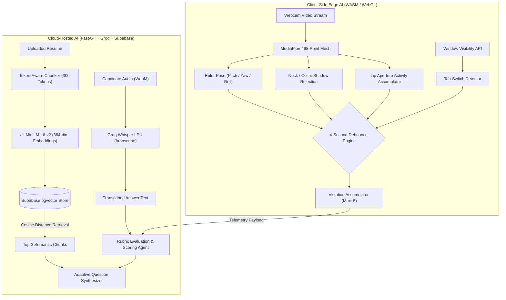

# Coach – AI Agents, RAG Pipeline & Edge Computer Vision

Coach employs a hybrid AI architecture that separates heavy generative intelligence from high-frequency telemetry. Reasoning, question generation, and speech transcription are executed in the cloud via Groq LPUs and LangChain, while real-time vision proctoring runs client-side inside the candidate's browser via WebAssembly (WASM) and WebGL.

---

## 1. System Agent Topology



---

## 2. Resume RAG Pipeline (Retrieval-Augmented Generation)

To avoid generic, pre-canned interview questionnaires, Coach dynamically grounds every interview session in the candidate's verified project experience.

### Document Ingestion & Chunking
* **Parsing:** Uploaded resumes (PDF, DOCX) are parsed via `resume_processor.py`. Non-alphanumeric noise, line-wraps, and non-standard bullet characters are sanitized.
* **Chunking Strategy:** Content is segmented into **300-token chunks** with a **50-token sliding window overlap** to preserve contextual boundaries across technical descriptions.

### Dense Vector Embeddings
* **Model:** `sentence-transformers/all-MiniLM-L6-v2`
* **Dimensionality:** 384-dimensional dense vectors
* **Storage:** Supabase PostgreSQL with the `pgvector` extension.
* **Vector Similarity Metric:** Cosine distance:
  $$\text{similarity} = 1 - \frac{\mathbf{u} \cdot \mathbf{v}}{\|\mathbf{u}\|_2 \|\mathbf{v}\|_2}$$

### Vector Search Function (`match_resume_chunks`)
```sql
CREATE OR REPLACE FUNCTION match_resume_chunks (
    query_embedding vector(384),
    match_threshold float,
    match_count int,
    filter_user_id UUID
)
RETURNS TABLE (
    id bigint,
    content text,
    similarity float
)
LANGUAGE plpgsql
AS $$
BEGIN
    RETURN QUERY
    SELECT
        resume_embeddings.id,
        resume_embeddings.content,
        1 - (resume_embeddings.embedding <=> query_embedding) AS similarity
    FROM resume_embeddings
    WHERE resume_embeddings.user_id = filter_user_id
      AND 1 - (resume_embeddings.embedding <=> query_embedding) > match_threshold
    ORDER BY similarity DESC
    LIMIT match_count;
END;
$$;
```

---

## 3. LLM Agent Prompt Engineering

Coach utilizes structured, multi-turn LLM chains implemented in `question_generator.py` and `feedback_service.py`.

### Initial Question Generation Agent
The first question is synthesized strictly from the top retrieved resume chunks:

```text
You are a Staff Software Engineer conducting an in-depth technical interview.

Resume Context:
{retrieved_resume_chunks}

Rules:
1. Ground the questions strictly in the technologies, architectures, and projects mentioned above.
2. Formulate exactly 8 progressive interview questions.
3. Start with conceptual fundamentals and escalate difficulty toward distributed systems, edge-case failure modes, and architectural trade-offs.
4. Output one question per line without numbers or introductory commentary.
```

### Adaptive Follow-Up & Feedback Agent
Rather than sticking to a rigid sequence, the system dynamically pivots based on candidate answers:

```text
You are an expert technical interviewer evaluating a software engineer's response.

Current Question: {current_question}
Candidate Answer: {candidate_answer}
Resume Context: {resume_context}

Evaluate the response against the following criteria:
1. Technical Correctness: Accuracy of algorithmic or architectural claims.
2. Depth & Nuance: Consideration of edge cases, complexity (Big-O), and failure modes.
3. Actionable Feedback: Provide a concise, constructive 2-sentence critique.
4. Adaptive Next Question: If the candidate answered poorly, formulate a targeted clarifying question on the missing concept. If answered well, escalate to a deeper architectural trade-off.

Format your output as JSON:
{
  "score": <0-100>,
  "critique": "<feedback_text>",
  "next_question": "<adaptive_question_text>"
}
```

---

## 4. Voice Processing & Speech-to-Text Pipeline

To minimize interview friction, voice interaction is handled asynchronously:

1. **Client-Side Media Capture:** The candidate’s audio stream is recorded using `MediaRecorder` in chunks of `audio/webm;codecs=opus`.
2. **Groq LPU Acceleration:** The WebM buffer is transmitted via `POST /transcribe` directly to the **Groq Whisper Large v3** endpoint:
   ```python
   transcription = groq_client.audio.transcriptions.create(
       file=(file.filename or "recording.webm", audio_bytes),
       model="whisper-large-v3",
       temperature=0.0,
       language="en"
   )
   ```
3. **Turnaround Latency:** Whisper transcription on Groq LPUs finishes in **< 400ms**, delivering near-instant text feedback in the candidate’s input terminal.
4. **Voice Output (TTS):** The questions and feedback are vocalized by the browser's native `window.speechSynthesis` engine, incurring zero network transfer latency.

---

## 5. Edge Computer Vision Proctoring Engine (`proctoringService.js`)

Streaming continuous 30 FPS video to a cloud backend for computer vision inference introduces unsustainable bandwidth and compute costs. Coach runs full facial landmark analysis **entirely on the client's GPU** using **Google MediaPipe FaceLandmarker**.

### 1. Head Pose Estimation (Pitch, Yaw, Roll)
The engine evaluates 3D facial coordinates relative to normalized camera space:
* **Yaw (Looking Left / Right):**
  Calculated from the horizontal ratio of the nose tip relative to the left and right temple landmarks. An absolute deviation greater than 28 degrees triggers an alert.
* **Pitch (Looking Down at Notes or Secondary Screens):**
  Tracked via normalized vertical coordinates (`landmark[1].y`). If `verticalPosition > 0.63`, the system identifies the candidate as looking down at their desk, paper, or a mobile device.

### 2. Neck & Collar Shadow Rejection Heuristic
A major flaw in naive multi-face detectors is mistaking neck creases, chin shadows, or dark shirt collars for a second human face. Coach implements a geometric spatial filter:

```javascript
// Filter out chin/neck fold false positives
const isNeckShadow =
  Math.abs(face1CenterX - face2CenterX) < face1Width * 0.35 &&
  face2CenterY > face1CenterY;

if (isNeckShadow) {
  // Reject candidate secondary face — treat frame as single-user
  effectiveFaceCount = 1;
}
```

### 3. Whisper / Lip Movement Detection (Off-Mic Speech)
To detect candidates receiving whispered external assistance while their microphone is muted, the system monitors mouth aperture:
* **Metrics:**
  * `verticalAperture`: Euclidean distance between top and bottom inner lips (`landmarks[13]` and `landmarks[14]`).
  * `horizontalSpan`: Distance between lip corners (`landmarks[61]` and `landmarks[291]`).
* **Leaky Accumulator Pattern:**
  Natural speech alternates rapidly between open vowels and closed consonants. Instead of resetting the flag counter on every consonant closure, an activity accumulator is used:
  ```javascript
  const isMouthActive = mouthAperture > 0.018 || mouthRatio > 0.055;

  if (isMouthActive && !isRecording) {
    talkingScore = Math.min(talkingScore + 2, 20); // Fast accumulation
  } else {
    talkingScore = Math.max(talkingScore - 1, 0); // Gentle consonant decay
  }

  if (talkingScore > 10 && !isRecording) {
    status = "WARNING";
    warning = "Lip movement detected while microphone is muted";
  }
  ```

### 4. 4-Second Strike Debounce & Disqualification Engine
To prevent transient glances from triggering immediate disqualification, violations are debounced:
* **Cooldown Window:** `VIOLATION_COOLDOWN_MS = 4000` (4 seconds). Consecutive flags within 4 seconds are aggregated into a single strike.
* **Strike Ladder & Disqualification:**
  * `Flags: 1 - 2`: Low penalty (10% integrity reduction per strike).
  * `Flags: 3 - 4`: High-risk state (Warning banner displayed).
  * `Flags >= 5`: **Automatic Termination**.
* **Termination Mechanics:**
  When `violationCount >= 5`:
  1. The live camera and audio streams are severed immediately.
  2. The interview concludes automatically with `POST /interview/end`:
     ```json
     {
       "interview_id": "...",
       "violation_count": 5,
       "integrity_score": 0
     }
     ```
  3. The candidate’s record is permanently flagged with an `Integrity Score: 0% (Disqualified)` incident card in `/history`.

---

## 6. Privacy & Security Architecture

1. **Zero Raw Video Retention:** All video frames are ingested directly into client-side WebGL canvas memory and processed in real-time. No video feeds or raw frames are ever transmitted to or stored on the backend.
2. **Stateless Feature Extraction:** MediaPipe landmarks are computed frame-by-frame and immediately overwritten. No persistent biometric templates are constructed.
3. **Encrypted Telemetry:** Only discrete integer counters (`violation_count`) and calculated metrics (`integrity_score`) are sent to Supabase over TLS 1.3.
