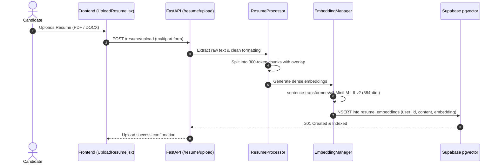
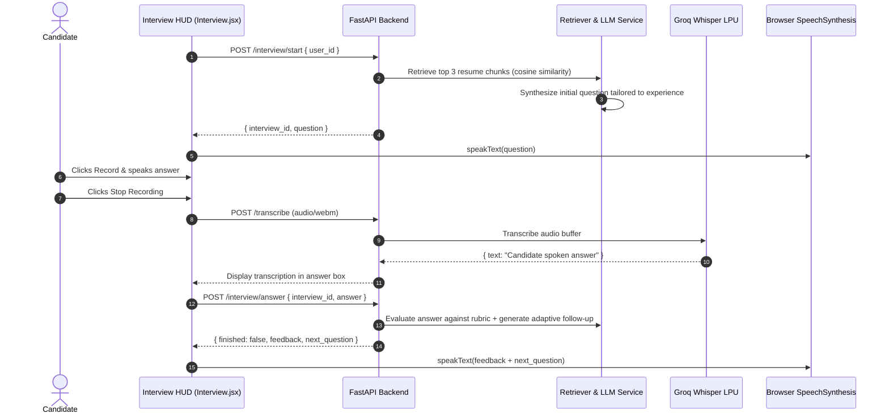
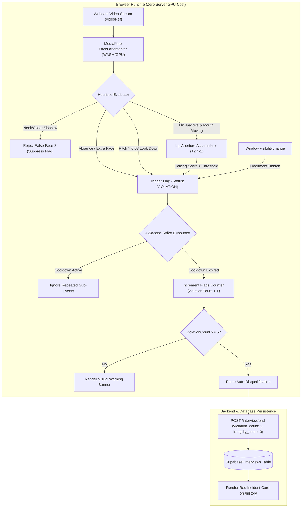
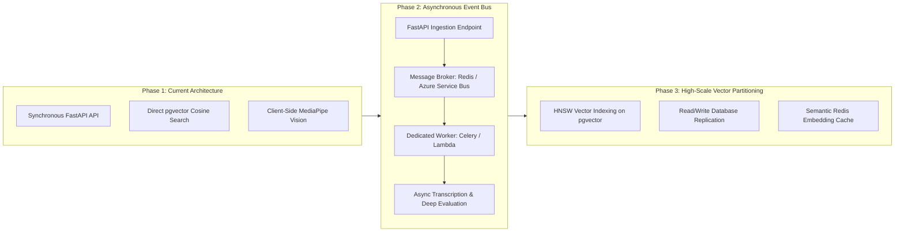

# Coach – Enterprise System Architecture & Multi-Cloud Specification

Coach is an AI-driven adaptive technical interview and automated proctoring platform. The system is designed to run across multiple cloud topologies, benchmarked against latency, operational cost, and deployment complexity.

---

## 1. Comprehensive Tech Stack Matrix

| Subsystem | Technology | Purpose & Implementation Details |
| :--- | :--- | :--- |
| **Frontend Framework** | React 18, Vite | Component-driven SPA, client-side routing via React Router, fast HMR bundling. |
| **Styling & HUD** | Tailwind CSS | Utility-first responsive design, dynamic proctoring HUD indicators, dark-accented UI. |
| **Edge Vision AI** | Google MediaPipe (`@mediapipe/tasks-vision`) | Client-side 468-point 3D facial landmark mesh executed on WebAssembly & WebGL. |
| **Audio Capture** | Web MediaStream & MediaRecorder API | Browser-native audio capture encoded as `audio/webm` buffers. |
| **Voice Synthesis** | Web Speech API (`SpeechSynthesis`) | Native browser text-to-speech for zero-latency question and feedback delivery. |
| **Backend Core** | Python 3.12, FastAPI, Uvicorn | Asynchronous REST API, non-blocking I/O, Pydantic v2 strict schema enforcement. |
| **Speech-to-Text** | Groq Cloud Whisper API (`whisper-large-v3`) | Sub-second audio transcription offloaded to high-throughput LPU hardware. |
| **LLM & Reasoning** | Groq / LangChain Core | Context-aware adaptive question synthesis and evaluation against scoring rubrics. |
| **Embeddings Model** | `sentence-transformers/all-MiniLM-L6-v2` | Generates 384-dimensional dense vector embeddings from resume text chunks. |
| **Database & Vectors** | Supabase (PostgreSQL 15 + `pgvector`) | Relational session storage, cosine distance vector similarity search (`<=>`). |
| **Identity & Auth** | Supabase Auth / AWS Cognito / Microsoft Entra ID | Multi-provider JWT authentication and role-based route protection. |
| **CI / CD** | GitHub Actions | Automated build, test, container push, and deployment across AWS and Azure. |

---

## 2. Multi-Cloud Architecture Matrix

The platform is designed with 4 discrete hosting topologies across AWS and Microsoft Azure:

| # | Architecture Tier | Cloud Provider | Frontend Hosting | Backend Compute | Identity Provider | Cost Profile | Operational Status |
| :--- | :--- | :--- | :--- | :--- | :--- | :--- | :--- |
| **1** | **PaaS Standard** | **AWS** | AWS Amplify Hosting | AWS Elastic Beanstalk (Python) | Supabase Auth | Low (`USD 10-15/mo`) | On-Demand Standby |
| **2** | **PaaS Standard** | **Azure** | Azure Static Web Apps | Azure App Service (Linux, B1) | Microsoft Entra / Supabase | **`USD 0/mo`** | **ACTIVE (Live Demo)** |
| **3** | **Enterprise Container** | **AWS** | AWS S3 + CloudFront CDN | AWS ECS Fargate + ALB | AWS Cognito User Pools | High (`USD 45-65/mo`) | On-Demand Standby |
| **4** | **Microservice Container**| **Azure** | Azure Storage (`$web`) | Azure Container Apps (ACA Korea) | Azure AD / Supabase | Medium (`USD 15-25/mo`) | On-Demand Standby |

---

## 3. Deep Dive: The 4 Architecture Implementations

### Architecture #1: AWS PaaS Standard (Amplify + Elastic Beanstalk)
* **Frontend:** Hosted via **AWS Amplify CI/CD** with direct GitHub repository branch tracking.
  * *Endpoint:* `https://main.dfef58a7porfq.amplifyapp.com`
* **Backend:** Packaged with `Procfile` on **AWS Elastic Beanstalk** (Python 3.12 on Amazon Linux 2023).
  * *Endpoint:* `http://coach-backend-env.eba-82exqwu5.ap-south-1.elasticbeanstalk.com`
* **Network & Security:** Managed single-instance environment with AWS-managed reverse proxy (Nginx).

---

### Architecture #2: Azure PaaS Standard (Static Web Apps + App Service) — [ACTIVE]
* **Frontend:** Deployed via GitHub Actions to **Azure Static Web Apps** with automated SSL and edge routing.
  * *Endpoint:* `https://thankful-plant-0e7dba400.2.azurestaticapps.net`
* **Backend:** **Azure App Service (Linux)** running FastAPI via Uvicorn on port 8000.
  * *Endpoint:* `https://arnav-coach-student-2026.azurewebsites.net`
* **Operational Profile:** Active continuous evaluation runtime. Zero server maintenance, zero base billing on student/basic tier, with a cold-start tradeoff (~20 seconds) when woken from idle state.

---

### Architecture #3: AWS Enterprise Container Cluster (CloudFront + ECS Fargate)
* **Frontend:** Production Vite build synced to **Amazon S3** distributed globally via **Amazon CloudFront CDN**.
  * *Custom Domain:* `https://www.coachinterview.tech`
  * *Direct CDN URL:* `https://d36vtqnt7szogv.cloudfront.net`
* **Backend:** Dockerized FastAPI image pushed to **Amazon ECR** (`308657715435.dkr.ecr.ap-south-1.amazonaws.com/coach-backend`), orchestrated across multiple Availability Zones on serverless **AWS ECS Fargate** behind an **AWS Application Load Balancer (ALB)**.
  * *ALB Ingress:* `http://coach-alb-1029412538.ap-south-1.elb.amazonaws.com`
* **Identity:** Integrated with **AWS Cognito User Pools**.
* **FinOps Rationale:** Full enterprise redundancy. Kept in standby state to prevent constant idle billing on Application Load Balancers and NAT Gateway hours.

---

### Architecture #4: Azure Cloud-Native Container Cluster (Storage Web + ACA Korea)
* **Frontend:** Static asset bundle hosted in **Azure Blob Storage Static Website (`$web` container)**.
  * *Endpoint:* `https://coachstaticstudent.z58.web.core.windows.net`
* **Backend:** Microservice container deployed to serverless **Azure Container Apps (ACA)** in region `Korea Central`, pulling from **Azure Container Registry (ACR)**.
  * *Endpoint:* `https://coach-backend-korea.nicepond-ae0bbb9d.koreacentral.azurecontainerapps.io`
* **Operational Profile:** Scale-to-zero container architecture with event-driven scaling triggers.

---

## 4. End-to-End System Data Flows

### Flow A: Resume Ingestion & RAG Indexing Pipeline


---

### Flow B: Live Adaptive Interview & Voice Interaction Loop


---

### Flow C: Client-Side Edge AI Proctoring & Disqualification Pipeline


---

## 5. Complete Project Directory Structure

```text
Coach/
├── .github/
│   └── workflows/
│       ├── deploy-aws-frontend.yml             # AWS S3 sync + CloudFront cache invalidation
│       ├── azure-static-web-apps-*.yml         # Azure Static Web Apps build & deploy
│       └── main_arnav-coach-student-2026.yml  # Azure App Service Python deployment
│
├── backend/
│   ├── app.py                                 # FastAPI application, CORS, routes & exception handlers
│   ├── requirements.txt                       # Backend Python dependencies
│   ├── Dockerfile                             # Container build specification (ECS / ACA)
│   ├── schemas/
│   │   └── interview.py                       # Pydantic models (EndInterviewRequest, AnswerRequest)
│   └── services/
│       ├── app_feedback_service.py             # User feedback submission handler
│       ├── embedding_manager.py               # 384-dimensional dense vector generator
│       ├── feedback_repository.py             # Answer evaluation database persistence
│       ├── feedback_service.py                # LLM response grading logic
│       ├── history_service.py                 # Historical session & report aggregator
│       ├── interview_repository.py            # Supabase database interaction layer
│       ├── interview_service.py               # Interview session state & lifecycle manager
│       ├── llm.py                             # Groq / LLM client initialization
│       ├── question_generator.py              # Context-aware dynamic question generator
│       ├── rag_service.py                     # Retrieval-Augmented Generation coordinator
│       ├── resume_processor.py                # Document parsing (PDF/DOCX) & text chunker
│       ├── retriever.py                       # Vector cosine similarity search query
│       ├── supabase_client.py                 # Supabase client singleton
│       └── vector_store.py                    # pgvector database operations
│
├── frontend/
│   ├── package.json                           # Node.js dependencies & scripts
│   ├── vite.config.js                         # Vite build configuration
│   ├── tailwind.config.js                     # Tailwind CSS styling framework
│   └── src/
│       ├── App.jsx                            # Route definitions & authentication provider
│       ├── main.jsx                           # Application entrypoint
│       ├── pages/
│       │   ├── Home.jsx                       # Platform landing page
│       │   ├── UploadResume.jsx               # Resume upload & embedding extraction UI
│       │   ├── Interview.jsx                  # Live interview HUD, proctoring HUD, voice I/O
│       │   ├── History.jsx                    # Interview evaluations, integrity badges & reports
│       │   └── Feedback.jsx                   # Application review & feedback
│       └── services/
│           ├── api.js                         # Axios client with base URL configuration
│           ├── proctoringService.js           # MediaPipe vision detection, pose & strike heuristics
│           └── supabase.js                    # Supabase client initialization
│
└── docs/
    ├── arch.md                                # This document (System architecture)
    ├── agents.md                              # AI agent reasoning, prompt chains & proctoring models
    └── design_system.md                       # UI/UX design tokens, HUD components & layouts
```

---

## 6. FinOps & Cloud Economics Breakdown

Running multiple enterprise cloud architectures concurrently can lead to rapid budget exhaustion. Coach implements a **FinOps-governed deployment model**:

| Cost Component | Architecture #3 (AWS Enterprise) | Architecture #2 (Azure PaaS - Live) | FinOps Action Taken |
| :--- | :--- | :--- | :--- |
| **Compute Engine** | ECS Fargate (`0.5 vCPU, 1 GB RAM` running 24/7): `~USD 15/mo` | Azure App Service (Linux B1/Free Tier): `~USD 0/mo` | Fargate scale-to-zero when not under evaluation. |
| **Ingress / ALB** | Application Load Balancer (`~USD 22/mo` base idle): `~USD 22/mo` | Integrated App Service URL routing: `USD 0/mo` | ALB provisioned on-demand via IaC. |
| **Edge CDN** | CloudFront CDN (`coachinterview.tech`): `< USD 1/mo` | Azure Static Web Apps: `USD 0/mo` | CloudFront maintained for global edge performance. |
| **Egress & NAT** | NAT Gateway for private subnets: `~USD 32/mo` | Native Azure Outbound Internet: `USD 0/mo` | NAT Gateway destroyed when demo is idle. |
| **Total Monthly Burn** | **`~USD 70/month`** | **`~USD 0 - 5/month`** | **92% Cost Reduction** while maintaining reproducible deployment manifests. |

---

## 7. Future Scalability & Production Roadmap



1. **Decoupled Asynchronous Evaluation Workers:**
   * Transition long evaluation chains from synchronous HTTP requests to an event-driven queue (Redis Queue / Azure Service Bus).
   * FastAPI returns immediate task receipts (`HTTP 202 Accepted`), freeing worker threads while background workers score answers against rubrics.
2. **Vector Database Scaling (HNSW Indexing):**
   * Replace exact sequential scans with Hierarchical Navigable Small World (`HNSW`) index structures in Supabase:
     ```sql
     CREATE INDEX ON resume_embeddings USING hnsw (embedding vector_cosine_ops);
     ```
   * Enforces logarithmic retrieval time `O(log N)` across hundreds of thousands of candidate resume chunks.
3. **WebRTC Low-Latency Live Ingestion:**
   * Upgrade audio upload from buffered WebM snippets to bidirectional WebRTC audio streaming, allowing live real-time conversational interruptions and sub-200ms latency.
4. **Automated Multi-Region Failover:**
   * Configure Route 53 latency-based routing between AWS CloudFront and Azure Static Web Apps to fail over dynamically if one cloud provider experiences a regional outage.
