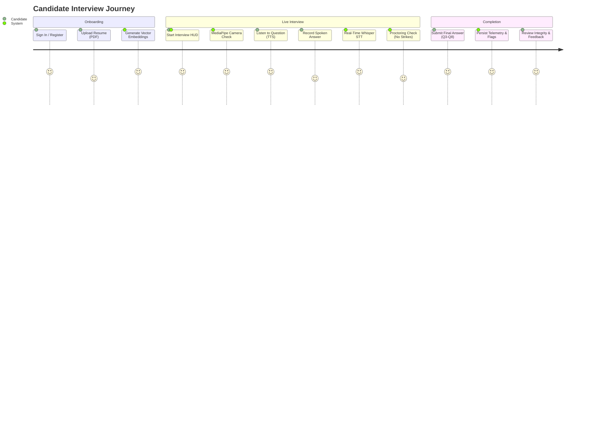

# Product Requirements Document (PRD) – Coach AI Interview Platform

**Product Name:** Coach  
**Document Version:** 1.0.0  
**Target Domain:** `https://www.coachinterview.tech`  
**Document Status:** Approved for Production Baseline  

---

## 1. Executive Summary & Value Proposition

Traditional technical interview preparation platforms rely on static question banks that fail to adapt to a candidate's distinct resume experience or simulate the real-time pressure of live proctoring. Conversely, commercial remote proctoring software requires heavy desktop agents, streams raw video to cloud servers (introducing privacy and compute cost hurdles), and flags false positives on natural human movements.

**Coach** is an autonomous, full-stack AI interview coach that solves both problems:
1. **Dynamic Resume Grounding:** Employs Retrieval-Augmented Generation (RAG) over Supabase `pgvector` to tailor technical questions to candidate projects.
2. **Zero-Server-Cost Edge Vision Proctoring:** Executes 468-point facial mesh tracking inside the candidate's browser via Google MediaPipe (WASM/WebGL), detecting head tilt, tab switches, and off-mic whispering without streaming video to servers.
3. **Adaptive Evaluation:** Progressively challenges candidates based on their answer quality and delivers actionable, rubric-scored performance reports.

---

## 2. User Personas

| Persona | Role | Primary Goal | Pain Point Addressed |
| :--- | :--- | :--- | :--- |
| **The Candidate** | Software Engineer preparing for interviews | Practice realistic, spoken technical interviews tailored to their resume with objective feedback. | Generic LeetCode questions do not test verbal explanation skills or project-specific system design depth. |
| **The Academic / Reviewer** | College Professor / Technical Evaluator | Verify that a student's project architecture is scalable, cost-effective, and functional. | Lack of tangible live deployments, high cloud hosting costs, or fragile demonstrations. |
| **The Recruiter / Interviewer** | Hiring Manager / Talent Acquisition | Audit candidate integrity and verbal communication before scheduling costly on-site loops. | High candidate fraud (whispering, external screens) and inconsistent interview rubrics. |

---

## 3. Functional Requirements (FR)

### FR-1: Authentication & Session Management
* **FR-1.1:** The system shall support secure user authentication via Supabase Auth (JWT-based session storage).
* **FR-1.2:** Unauthenticated users shall be restricted from initiating interviews, uploading resumes, or accessing evaluation history.
* **FR-1.3:** The backend shall validate user identity via Bearer tokens on protected endpoints.

### FR-2: Resume Ingestion & Semantic Vector Indexing
* **FR-2.1:** Candidates shall upload resumes in `.pdf` or `.docx` format up to 10 MB.
* **FR-2.2:** The backend parser shall sanitize non-alphanumeric noise and extract structured text blocks.
* **FR-2.3:** The parser shall segment text into **300-token chunks** with a **50-token sliding window overlap**.
* **FR-2.4:** The system shall compute 384-dimensional dense vector embeddings using `sentence-transformers/all-MiniLM-L6-v2`.
* **FR-2.5:** Embeddings shall be persisted in the Supabase PostgreSQL database using the `pgvector` extension.

### FR-3: Voice-Enabled Adaptive Interview Flow
* **FR-3.1:** The interview session shall initialize with a resume-grounded question retrieved via cosine similarity search (`match_resume_chunks`).
* **FR-3.2:** Questions and AI feedback shall be vocalized in real-time via the browser's native `SpeechSynthesis` API.
* **FR-3.3:** Spoken candidate answers shall be captured via `MediaRecorder` (`audio/webm`) and transcribed by Groq Whisper Large v3 within 500 ms.
* **FR-3.4:** After each answer, the LLM shall evaluate response accuracy against a technical rubric and synthesize an adaptive follow-up.
* **FR-3.5:** An interview shall support up to 8 progressive questions. Candidates shall be permitted to terminate early after question #3.

### FR-4: Client-Side Edge AI Proctoring
* **FR-4.1:** Video capture and inference shall run entirely client-side using MediaPipe's WebAssembly and GPU delegates. **Zero video frames shall be transmitted to the cloud.**
* **FR-4.2 (Head Pose Tracking):** The system shall compute 3D Euler angles. A downward pitch deviation (`verticalPosition > 0.63`) sustained across frames shall register as looking down at desk notes or mobile devices.
* **FR-4.3 (Neck Shadow Rejection):** The system shall verify spatial geometry between detected faces. Secondary faces directly below the chin within 35% horizontal alignment shall be rejected as collar/neck shadows.
* **FR-4.4 (Whisper Detection):** When the microphone is inactive, mouth aperture (`landmarks[13]` to `landmarks[14]`) shall be tracked via a leaky accumulator (`+2` open, `-1` closed). An accumulator score above 10 shall trigger a muted speech warning.
* **FR-4.5 (Tab-Switching):** The `visibilitychange` API shall trigger a strike if the candidate switches browser tabs.
* **FR-4.6 (Strike Debouncing):** Violations shall be debounced by a 4-second cooldown window (`VIOLATION_COOLDOWN_MS = 4000`) to prevent strike inflation from a single glance.

### FR-5: Deterministic Disqualification & Integrity Scoring
* **FR-5.1:** If `violationCount` reaches or exceeds **5 strikes**, the interview session shall terminate immediately.
* **FR-5.2:** For auto-terminated sessions, the system shall assign `integrity_score = 0` (Status: Disqualified).
* **FR-5.3:** For non-terminated sessions, integrity shall calculate as:
  $$\text{Integrity Score} = \max(0, 100 - (\text{violationCount} \times 10))$$
* **FR-5.4:** The backend shall record `{ violation_count, integrity_score, status: 'completed' }` to the `interviews` table.

### FR-6: Evaluation History & Audit Reporting
* **FR-6.1:** Candidates can view all past sessions at `/history`.
* **FR-6.2:** Each history card shall display the date, overall technical score, integrity score badge, and total violation count.
* **FR-6.3:** Disqualified interviews shall render a red incident report card with an audit flag.

---

## 4. Non-Functional Requirements (NFR)

### NFR-1: Latency & Response Times
* **NFR-1.1:** STT audio transcription turnaround (upload buffer -> Groq Whisper -> text in input box) shall complete in `< 500 ms`.
* **NFR-1.2:** MediaPipe computer vision inference shall sustain **15 to 30 FPS** on standard integrated GPUs without causing audio stutter.
* **NFR-1.3:** Question synthesis and answer grading via LLM shall respond within `< 2.0 s`.

### NFR-2: FinOps & Operational Cost Target
* **NFR-2.1:** The default continuous production baseline (Architecture #2 – Azure PaaS) shall incur **USD 0.00/month** in base compute costs on developer tiers.
* **NFR-2.2:** High-cost cloud infrastructure (Architecture #3 – AWS ECS Fargate + ALB) must have automated scale-to-zero / standby configurations to prevent personal credit burn.

### NFR-3: Privacy, Data Protection & SAIF Alignment
* **NFR-3.1:** No raw webcam imagery, video clips, or biometric landmark templates shall be written to disk or sent across the network.
* **NFR-3.2:** Spoken audio WebM buffers must be discarded in memory immediately following Groq Whisper transcription.
* **NFR-3.3:** All cloud data in transit must enforce TLS 1.3 encryption.

### NFR-4: Cross-Browser Compatibility
* **NFR-4.1:** The primary supported client runtimes are **Google Chrome (v110+)** and **Microsoft Edge (Chromium v110+)** for reliable WebAssembly GPU access and Web Speech API synthesis.

---

## 5. End-to-End User Journeys

---

## 6. Acceptance Criteria (Sample Test Scenarios)

### Scenario A: Resume-Grounded First Question
* **Given** a candidate uploads a resume detailing experience with `"Apache Kafka and FastAPI"`,
* **When** the candidate clicks *"Start Interview"*,
* **Then** the vector search retrieves chunks mentioning Kafka, and Question #1 specifically references distributed streaming or Kafka pipelines.

### Scenario B: 4-Second Strike Debounce
* **Given** a live interview session with `Flags: 1`,
* **When** the candidate looks down at their phone twice within 2.5 seconds,
* **Then** the proctoring badge must remain at `Flags: 1` due to the 4-second cooldown window.
* **When** the candidate looks down again 5 seconds later,
* **Then** the badge increments to `Flags: 2`.

### Scenario C: Auto-Disqualification
* **Given** a candidate who has accumulated `Flags: 4`,
* **When** the candidate switches tabs or looks away after the cooldown period,
* **Then** `Flags` reaches `5`, the camera stream stops immediately, a disqualification alert announces via TTS, and the session writes `integrity_score = 0` to Supabase.

---

## 7. Project Constraints & Technical Dependencies

1. **Third-Party Model APIs:** Relies on Groq Cloud API for Whisper STT and Llama/LLM reasoning. In the event of an outage, graceful fallback error banners must alert the user.
2. **Local Camera & Mic Permissions:** The client application requires explicit browser hardware permissions (`navigator.mediaDevices.getUserMedia`). Rejection must display an onboarding permission guard.
3. **Azure App Service Cold-Starts:** On free/basic App Service tiers, an idle container requires a ~20-second wake-up window on the first API call.

---

## 8. Out of Scope (Future Roadmap – v2.0)

* **Code Execution Sandbox:** In-browser IDE for running Python/JavaScript code snippets.
* **Multi-Party Panels:** Multi-candidate group interview simulations.
* **Automated Audio Diarization:** Isolating candidate voice from background room chatter using speaker identification models.
